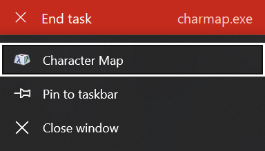

# Taskbar End Task

Force-close a frozen app straight from the Windows taskbar, without opening Task Manager.

Windows 11 has an "End task" item in the taskbar's right-click menu. Windows 10 never got it. This adds it.



- **Right-click** an app on the taskbar and click **End task** on top of its menu.
- Or **hover** the app on the taskbar and press **Ctrl+Shift+E**.

The app is ended immediately, together with every process it started (like `taskkill /T /F`). Unsaved work in that app is lost, exactly as with Task Manager's "End task".

One small exe (about 160 KB) that sets itself up. No administrator rights, no background service, no network access.

## Download

Get `EndTask.exe` from the [latest release](../../releases/latest) and run it. The first time, it asks whether to set itself up:

- **Yes** copies it to `%LOCALAPPDATA%\Programs\TaskbarEndTask` and starts it with Windows. You can delete the downloaded file afterwards.
- **No** just runs it from where it is. You can still tick **Start with Windows** in the tray menu, or run `EndTask.exe --install` later.

Either way a red icon appears in the notification area; that is the whole program. To update, download the new exe and run it: it offers to replace the installed copy.

Windows SmartScreen may warn about the exe because it is not code-signed. You can check the SHA-256 printed in the release notes, or [build it yourself](#building) in a few seconds.

## Running it as administrator

A normal copy cannot end apps that run as administrator (Task Manager, installers, many system tools). If you want that, start `EndTask.exe` with **Run as administrator**; everything else works the same.

Starting with Windows is different for such a copy. Windows silently skips anything in its normal startup list that needs administrator rights, so a copy running as administrator registers a scheduled task instead ("run with highest privileges, at sign-in"). You do not have to do anything: tick **Start with Windows (as administrator)** in the tray menu, or answer Yes to the setup question while running as administrator. In that case it installs to `%ProgramFiles%\TaskbarEndTask`, where other programs cannot overwrite it.

If you marked the exe "Run this program as an administrator" in its Properties and it stopped starting with Windows, just start it once: it notices and moves its startup entry to a scheduled task.

## Tray menu

| Item | What it does |
| --- | --- |
| Start with Windows | Adds or removes the exe from your sign-in startup (`HKCU\...\Run`; a scheduled task when running as administrator). Also shows unticked if Task Manager's Startup tab has disabled the entry, and ticking it switches it back on. |
| Ctrl+Shift+E hotkey | Turns the hover hotkey on or off. |
| Use Windows 11's built-in "End task" | Only on Windows 11 22H2/23H2 builds that have it: switches the native menu item on or off. |
| How to use… | A short reminder. |
| Exit | Stops the program. |

## Command line

| Switch | Effect |
| --- | --- |
| `--install` | Sets it up without asking: copies the exe to `%LOCALAPPDATA%\Programs\TaskbarEndTask`, adds it to startup and starts it. |
| `--uninstall` | Stops the running copy and removes the startup entry, the settings and the installed copy. |
| `--exit` | Stops the running copy. |
| `--log` | Writes what it sees and does to `%TEMP%\TaskbarEndTask.log`. Attach this to bug reports. |
| `--dry-run` | Like `--log`, but nothing is actually ended. Useful for checking which processes a taskbar button resolves to. |

Starting the exe while a copy is already running replaces the running copy. The one exception: a copy that was started as administrator can only be replaced by another one started as administrator; otherwise you are told to exit it from its tray icon first.

## Which Windows versions

| System | Behaviour |
| --- | --- |
| Windows 10 | The End task button and the hotkey. |
| Windows 11, build 22631.2715 or later | On first run it switches on Windows' own "End task" menu item (you can switch it off again in the tray menu) and adds the hotkey. |
| Windows 11, older builds | The button and the hotkey. |

**Tested on:** Windows 10 LTSC 2021 (build 19044), taskbar at the bottom, dark theme, 150 % scaling, one monitor.

**Written for but not yet tested on:** Windows 11, a taskbar docked to the top or sides, the light theme, mixed-DPI multi-monitor setups. Reports from these setups are welcome; please include a `--log` file.

## How it works

Windows offers no API that says "this taskbar button belongs to that process", so the program works it out:

1. It reads the accessible name of the button under the cursor, for example `Notepad - 1 running window`.
2. It compares that name with every visible top-level window: the exe's file description and product name, the window title, and the exe name. The best match wins. A pinned shortcut whose app is not running has no window count in its name, and then only an exact match is accepted.
3. When the right-click menu opens, it places a small borderless window directly on top of it and keeps it there: the button moves with the menu and disappears when the menu closes. It shows the exe name it resolved to (`End task … notepad.exe`), so you can see what will be ended before you click.
4. On click or hotkey it opens handles to the process and its children, checks each one against its creation time so a recycled process ID can never be hit, and terminates them.

It never offers or ends Explorer, the shell hosts, system processes, or any process Windows marks as critical.

There are no hooks and no code injection. A 30 ms timer runs while the cursor is on the taskbar (120 ms otherwise) and polls the state of Ctrl, Shift, Alt, Win, E and Esc. Mouse button presses arrive through Raw Input, which only delivers events and cannot intercept them, and it is switched on only while the cursor is on the taskbar or the button is showing. Nothing is recorded or sent anywhere; the program makes no network connections.

## Limitations

- Matching is a heuristic. If the button shows the wrong exe name, do not click it; run with `--dry-run` and open an issue with the log.
- Apps running as administrator can only be ended if Taskbar End Task itself runs as administrator (see above). Otherwise you get a notification saying so.
- File Explorer windows cannot be ended this way, on purpose: they live in the same process as the taskbar.
- The hotkey is fixed to Ctrl+Shift+E. To change it, edit `HOTKEY_VK` in `src/EndTask.c` and rebuild.

## Building

You need [Zig](https://ziglang.org/) (it bundles a C compiler and the Windows headers; Visual Studio is not required):

```powershell
winget install zig.zig
```

```powershell
powershell -ExecutionPolicy Bypass -File build.ps1
```

The result is `build\EndTask.exe`. The source is one C file, [`src/EndTask.c`](src/EndTask.c), plus an icon, a manifest and version information in `src/EndTask.rc`. The icon is generated by `tools/make-icon.ps1`.

Release binaries are built by GitHub Actions from the tagged source; see [`.github/workflows/build.yml`](.github/workflows/build.yml).

## Uninstalling

Run any copy of the exe with `--uninstall`:

```powershell
.\EndTask.exe --uninstall
```

This removes the startup entry, the settings and the installed copy. If you run it from the installed copy itself, it cannot delete its own file and tells you which folder to delete.

## License

[MIT](LICENSE)
